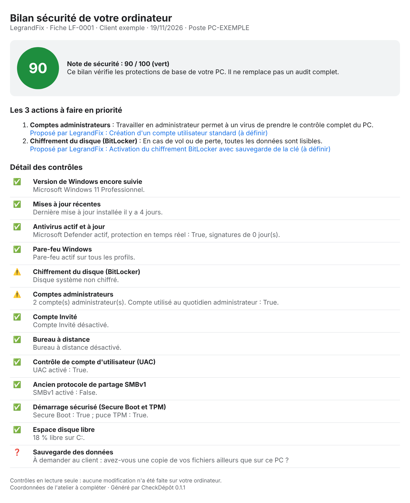

# CheckDépôt

**Le bilan sécurité qu'un réparateur remet à son client à chaque PC déposé.**

Les outils d'audit Windows existent déjà, mais ils parlent aux experts. CheckDépôt parle au client : une page en français simple, une note sur 100, un code couleur et les 3 actions à faire en priorité. Pour le réparateur, chaque problème trouvé devient une prestation qu'il peut proposer.



> Projet en cours (semaine 1). Testé sur Windows 11 Professionnel, Windows PowerShell 5.1, le 19/11/2026.

## Pourquoi
Selon le baromètre Cybermalveillance.gouv.fr 2025, l'hameçonnage cause 43 % des incidents chez les TPE-PME, seulement 26 % ont activé la double authentification, et huit sur dix reconnaissent manquer de préparation. Les particuliers et les TPE confient leur PC au réparateur du quartier : c'est le meilleur moment pour leur montrer, simplement, où ils en sont.

## Ce que vérifie la version 0.1.1
| Contrôle | Pourquoi c'est important pour le client |
|---|---|
| Version de Windows encore suivie | Windows 10 ne reçoit plus de correctifs gratuits depuis le 14/10/2025 |
| Date de la dernière mise à jour | un PC pas à jour est la porte d'entrée la plus fréquente |
| Antivirus actif et signatures à jour | protection contre les fichiers piégés |
| Pare-feu | bloque les connexions non voulues |
| Chiffrement BitLocker | protège les données en cas de vol |
| Comptes administrateurs | limite les dégâts d'un virus |
| Compte Invité | empêche l'accès libre au PC |
| Bureau à distance | ferme une porte inutile |
| UAC | empêche les modifications silencieuses |
| SMBv1 | protocole exploité par WannaCry |
| Secure Boot et TPM | protège le démarrage |
| Espace disque | permet aux mises à jour de s'installer |
| Sauvegarde | question posée au client (non vérifiable par script) |

Tous les contrôles sont **en lecture seule** : le script ne modifie rien.

## Utilisation
1. Copier le dossier sur une clé USB.
2. Sur le PC du client, ouvrir PowerShell **en administrateur** dans le dossier.
3. Lancer :
   ```powershell
   powershell -ExecutionPolicy Bypass -File .\CheckDepot.ps1 -Client "Mme Durand" -Ticket "LF-0142"
   ```
4. Ouvrir le rapport HTML dans `rapports\`, puis Ctrl+P > Enregistrer en PDF.
5. Le fichier JSON garde l'historique (utilisé par le futur tableau de bord).

Le nom de l'atelier, le contact et les prestations proposées se règlent dans `config.json`.

## Feuille de route
- [x] 0.1.1 : 13 contrôles, score, rapport client, historique JSON, compatible PowerShell 5.1
- [ ] 0.2 : sauvegarde en action prioritaire, « oui / non » au lieu de « True / False »
- [ ] 0.3 : logiciels obsolètes (navigateurs, Java, lecteurs PDF), écran de verrouillage
- [ ] 0.4 : export PDF direct, logo de l'atelier
- [ ] Tableau de bord multi-clients (semaine 6)

## Journal des corrections
- 0.1.1 : `$PSScriptRoot` vide dans le bloc `param` sous Windows PowerShell 5.1 ; faux positif « compte sans mot de passe » (`PasswordRequired` ne dit pas si un mot de passe existe) ; compte Administrateur intégré désactivé compté à tort ; note verte malgré un point critique.

## Limites
Ce bilan vérifie les protections de base. Ce n'est ni un audit complet ni un test d'intrusion.

## Auteur
Legrand ATCHOU, cycle ingénieur Réseaux & Sécurité (EFREI Paris). [LinkedIn](https://www.linkedin.com/in/legrand-atchou)
